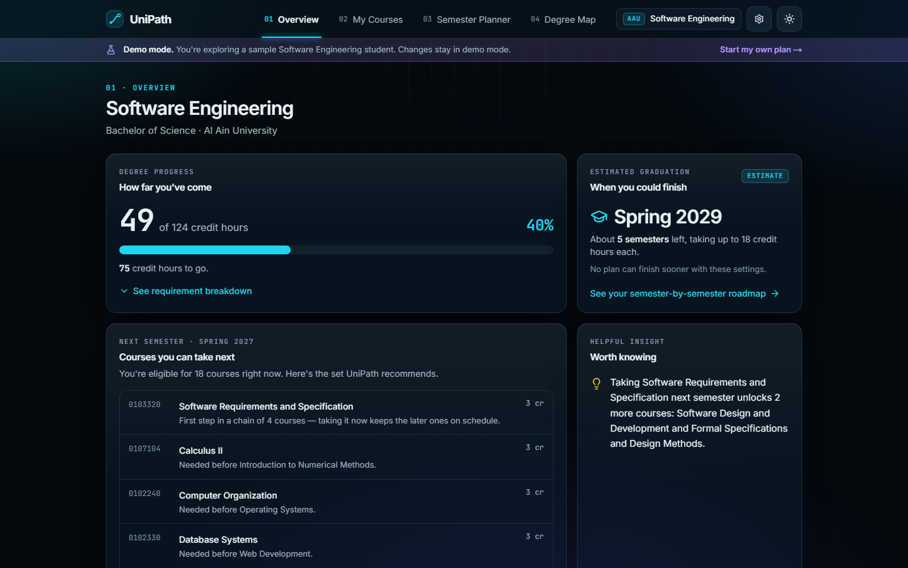
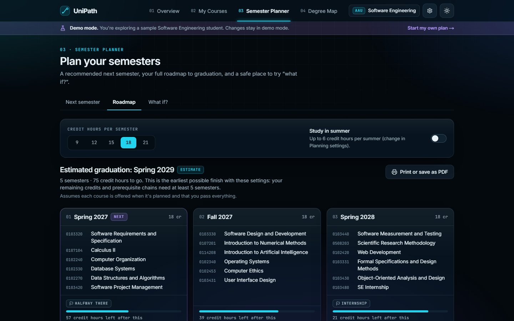
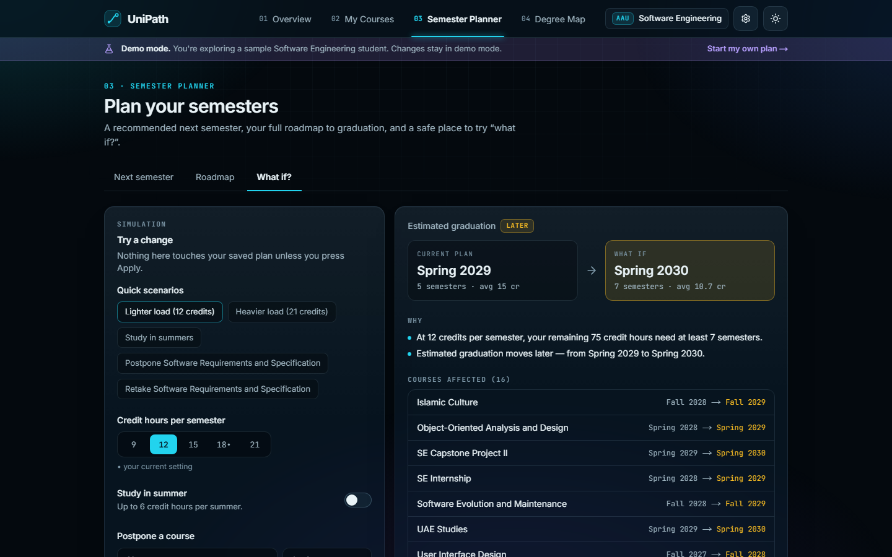
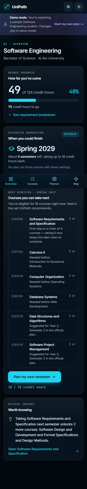

# UniPath

**Your degree. Your direction.**

UniPath turns a university's static study plan into a personal, interactive roadmap. Pick your major, tick the courses you've finished, and UniPath shows how far you are from graduating, what you can take next semester, what's blocking you, and how choices like a lighter workload or a postponed course change your graduation date.

Built for **NextSpark Hacks 2026**. No account, no API keys, no paid services — everything runs in the browser.



| Semester roadmap | What if? | Phone |
| --- | --- | --- |
|  |  |  |

> UniPath is an independent student project. It is not affiliated with or endorsed by Al Ain University. Course data is transcribed from publicly available study plans and may contain mistakes — always confirm your plan with your academic advisor.

---

## The problem

Degree requirements usually live in PDFs and tables. They don't know what *you* have already passed, so students have to work out by hand:

- which courses they still need, and which ones are blocked by prerequisites,
- what they can register for next semester,
- whether delaying or failing a course pushes back graduation,
- how many semesters are left.

## What UniPath does

| Screen | What you get |
| --- | --- |
| **Overview** | Credits completed vs required, estimated graduation, the courses you can take next, and one insight backed by the prerequisite graph (e.g. *"Taking Software Requirements and Specification next semester unlocks 2 more courses"*). |
| **My Courses** | Every course with a clear status — Completed, Planned, Available, Locked — plus search, filters, one-line "why it's locked" reasons, and a detail panel (prerequisite checklist, what it unlocks, which requirement it counts toward). Ticking a course updates everything instantly, with Undo. |
| **Semester Planner** | A recommended next semester with a reason for every course; add/remove courses with clear explanations when something isn't allowed; a warning (with the reason) if your choices delay graduation; a semester-by-semester **roadmap**; **key courses** you shouldn't put off; and a **What if?** simulator. |
| **Degree Map** | An interactive prerequisite graph (zoom, pan, fit, search, filter, click to highlight everything before and after a course), plus a list view for phones and screen readers. |

Also: guided onboarding, a **Try Demo** sample student, a frosted-glass design with dark and light themes (the dark colour oozes out of the theme toggle, and is sucked back into it when switching to light, using the View Transitions API), a landing page with smooth scrolling and scroll-driven animations (all disabled for visitors who prefer reduced motion), export/import of progress, printable roadmap, and an About page listing every data source and interpretation.

### Planning engine

All planning is deterministic and lives in [`src/lib/engine`](src/lib/engine), separate from the UI:

- **Prerequisite rules** support AND/OR combinations, minimum completed credit hours (e.g. internship ≥ 75), advisory conditions that can't be checked (department approval), corequisites, same-semester rules and minimum grades.
- **Next semester:** fills your credit limit with eligible courses, prioritising the longest remaining prerequisite chain, then courses with the most dependents, then the official suggested semester. A small "fill pass" swaps end-of-chain courses to use all available credits, so credit-hour thresholds open sooner.
- **Electives:** never picked on your behalf. Unchosen electives are open slots ("Major electives — your choice"); chosen electives pull in their own prerequisites.
- **Roadmap:** repeats the semester step until every requirement is met. It is a heuristic, so it only claims *"no plan can finish sooner"* when it can prove it: the plan's length equals a lower bound from your remaining credits and the longest prerequisite chain.
- **What if:** re-runs the same engine on a copy of your inputs (lighter/heavier load, summer terms, postponing a course, retaking a course) and explains the difference using the actual dependency graph. Your saved progress never changes unless you press **Apply**.

## Curriculum data

| Major | Credit hours | Status | Source |
| --- | --- | --- | --- |
| BSc Software Engineering | 124 | Transcribed from official study plan | [AAU study plan](https://engineering.aau.ac.ae/en/programs/bachelor-of-science-in-software-engineering) + Software Engineering Guidance Plan |
| BSc Computer Science | 123 | Transcribed from official study plan | [AAU study plan](https://engineering.aau.ac.ae/en/programs/bachelor-of-science-in-computer-science) + Computer Science Guidance Plan |
| BSc Cybersecurity | 123 | Transcribed from official study plan | [AAU study plan](https://engineering.aau.ac.ae/en/programs/bachelor-of-science-in-cybersecurity) + Cybersecurity Guidance Plan (2022) |

All three were transcribed by hand from public Al Ain University documents (retrieved 25 Oct 2026). **No illustrative or invented curricula are included.** Courses, credits and prerequisites come from each study plan; suggested semesters come from the guidance plans.

Where the documents disagree or reference courses that don't exist in the plan, UniPath records the interpretation as a visible data note (shown on the About page and on the affected course), for example:

- The Cybersecurity plan lists `0102320` as the prerequisite for Computer Forensics, but no such course is in the degree. UniPath shows it as "confirm with your advisor" rather than blocking the course.
- The Cybersecurity plan lists `0102431` as the prerequisite for Capstone Project II. UniPath assumes Capstone Project I comes first, as in the other engineering programs.
- Some guidance plans list courses that aren't in the study plan (or omit required ones). The study plan always wins.

Every bundled curriculum is validated at load time and in the test suite: required fields, duplicate codes, missing prerequisite references, circular prerequisites, invalid credits, requirement totals, impossible elective rules and unreachable credit thresholds. Curricula with errors are never offered to students.

### Adding a major or university

1. Add a JSON file in `src/data/curricula/<university>/` following the existing files (requirement groups containing courses; prerequisites in a small text format such as `0102221 & 0107200`, `(A & B) | D`, `credits>=60`, `[Department approval]`).
2. Register it in [`src/lib/curriculum/registry.ts`](src/lib/curriculum/registry.ts) (and add the university there if it's new).
3. Run `npm test` — the validator test fails if the data has problems.

No planning or UI code needs to change.

## Tech stack

Next.js 16 (App Router) · React 19 · TypeScript · Tailwind CSS 4 · Radix UI primitives · Lucide icons · React Flow (`@xyflow/react`) + dagre for the degree map · Zod for data and saved-state validation · Zustand for state · Sonner for toasts · Vitest · Playwright + axe-core.

## Getting started

Requirements: **Node.js 20.9 or newer** (developed on Node 22) and npm.

```bash
npm install
npm run dev
```

Open http://localhost:3000. Click **Try Demo** for a pre-filled sample student, or **Start Planning** to set up your own plan.

### Commands

| Command | What it does |
| --- | --- |
| `npm run dev` | Start the development server |
| `npm run build` / `npm start` | Production build / serve it |
| `npm run typecheck` | TypeScript check |
| `npm run lint` | ESLint |
| `npm test` | Unit tests (Vitest) |
| `npm run test:e2e` | End-to-end tests (Playwright; builds and starts the app on port 3100). Run `npx playwright install chromium` once first. |
| `npm run check` | Typecheck + lint + unit tests |

## Deployment

UniPath is a standard Next.js app with no environment variables or backend.

- **Vercel (free Hobby plan):** import the GitHub repository at vercel.com/new, keep the detected Next.js settings, and deploy.
- **Anywhere else:** `npm run build && npm start` on Node 20.9+.

## Saving and privacy

Progress is stored only in the browser's `localStorage` (versioned and validated with Zod). It never leaves the device, so it's lost if browser data is cleared — use **Settings → Export progress** to keep a copy. Unreadable saved data is never silently discarded: UniPath keeps a backup copy in the browser and tells the student. Progress is stored per major, so switching majors never mixes up completed courses; copying matching course codes between majors only happens when the student asks.

## Limitations

- Eligibility is not availability: UniPath has no section, timetable or seat data.
- Graduation estimates assume courses are offered when planned and passed on the first attempt (except in "retake" simulations).
- Grades, GPA, transfer credit and equivalencies aren't tracked. Department approvals are shown but not checked.
- Summer credit limits and maximum loads are user settings — check your university's rules.
- Only Al Ain University's Software Engineering, Computer Science and Cybersecurity plans are loaded.
- Transcription errors are possible.

## Project structure

```
src/
  app/                    routes: landing, /start, /demo, /about, and (app)/overview|courses|planner|map
  components/             UI, grouped by screen (app-shell, courses, planner, map, onboarding, landing, ui)
  data/curricula/aau/     curriculum JSON files
  lib/curriculum/         types, schema, prerequisite parser, validation, registry
  lib/engine/             progress, eligibility, targets, scheduler, insights, simulation, terms
  lib/state/              persisted-state schema, persistence, demo student, store
  lib/plan.ts             derives everything a screen needs from saved progress
e2e/                      Playwright tests
docs/ARCHITECTURE.md      design decisions
```

## Team

| Member | Contributions |
| --- | --- |
| Bilal Feroz | _[add contributions]_ |
| Faheem Abdul Azees | _[add contributions]_ |

## AI assistance disclosure

This project was built with substantial help from **Claude (Anthropic)** via Claude Code, which wrote most of the code, tests and documentation from the team's specification and the official study plan PDFs the team supplied. The team directed the work, chose the scope, and is responsible for reviewing it. UniPath itself uses **no AI at runtime**: every recommendation comes from the deterministic planning engine.

See [CREDITS.md](CREDITS.md) for all libraries and sources.
